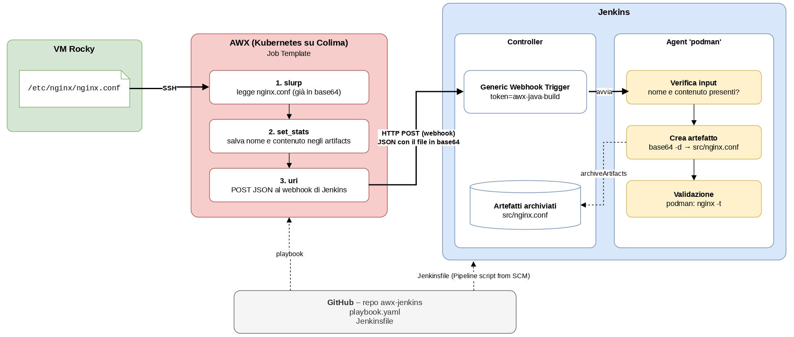

# AWX → Jenkins: prelievo e validazione di `nginx.conf`

## L'esercizio

Costruire una catena automatizzata tra tre strumenti:

1. **AWX** – un Job Template preleva un dato da una VM (qui `/etc/nginx/nginx.conf`).
2. **Webhook** – AWX chiama Jenkins passandogli il dato, che Jenkins salva come **artefatto**.
3. **Jenkins** – la chiamata avvia una pipeline che usa l'artefatto per una "build"
4. **Git** – il `Jenkinsfile` della pipeline viene letto da GitHub, non scritto dentro Jenkins.

## Il flusso



AWX entra nella VM via SSH e legge `nginx.conf`. Il contenuto viene codificato in **base64** (così a capo e caratteri speciali non rompono il JSON) e salvato negli **artifacts** del job. A fine job, una **notifica Webhook** di AWX lo invia con un POST al webhook di Jenkins. Il controller Jenkins riconosce il token, scarica il `Jenkinsfile` da GitHub e fa eseguire la pipeline sull'agent: il file viene ricostruito, archiviato come artefatto e validato con `nginx -t` dentro un container nginx.

## Il playbook (`playbook.yaml`)

| Task | Cosa fa |
|---|---|
| **Leggi il file** | `slurp` legge `nginx.conf` sulla VM e lo restituisce già in base64. A differenza di `fetch` non salva nulla sul disco del container AWX, che viene distrutto a fine job. |
| **Salva negli artifacts** | `set_stats` (con `per_host: false`) salva nome e contenuto come artifacts del job (`filename`, `content_b64`). È l'unico modo per far sopravvivere il dato alla fine del job: la notifica viene generata dopo e può leggere solo i dati salvati sul job. |

## Il webhook (Notification Template)

Notifica di tipo **Webhook** associata al Job Template sull'evento **Success**:

- **Target URL**: `http://<IP-JENKINS>:8080/generic-webhook-trigger/invoke?token=awx-nginx-build`
- **HTTP Method**: `POST`, header `{"Content-Type": "application/json"}`
- **Success message body**:

```json
{"awx_job_id": "{{ job.id }}", "filename": "{{ job.artifacts.filename | default('') }}", "content_b64": "{{ job.artifacts.content_b64 | default('') }}"}
```

Al momento dell'invio AWX sostituisce le variabili con i dati del job: `job.id` è il numero del job, `job.artifacts.*` sono i dati salvati da `set_stats`. I nomi a sinistra sono i campi letti dal Jenkinsfile (`$.filename`, `$.content_b64`).

## La pipeline (`Jenkinsfile`)

**`agent { label 'podman' }`** – gli stage girano sull'agent con label `podman`, non sul controller. Il controller riceve solo il webhook e conserva gli artefatti.

**`triggers`** – il plugin Generic Webhook Trigger avvia la pipeline quando arriva un POST con `token=awx-nginx-build` ed estrae i campi del JSON (JSONPath `$.campo`) in variabili d'ambiente.

| Stage | Cosa fa |
|---|---|
| **Verifica input** | Si ferma con un errore chiaro se mancano nome o contenuto del file(es. build lanciata a mano). |
| **Crea artefatto** | Decodifica il base64 e ricrea `src/nginx.conf` identico all'originale; `archiveArtifacts` lo copia sul controller come artefatto della build. `set +x` evita di stampare il base64 nel log. |
| **Validazione** | Avvia un container nginx con il file montato e lancia `nginx -t`: la build è verde solo se la configurazione è valida. `:Z` serve per SELinux (Rocky), che altrimenti impedisce al container di leggere il file. |

## Configurazione

### AWX
- **Installazione**: su Kubernetes (Colima) con il chart Helm `awx-operator` (`AWX.enabled=true`, service `ClusterIP`, accesso con `kubectl port-forward`).
- **Credential** `rocky-ssh` (tipo *Machine*): utente e chiave SSH della VM.
- **Inventory** `vms`: un host, l'IP della VM.
- **Project**: repo GitHub con playbook e Jenkinsfile
- **Job Template**: project + `playbook.yaml` + inventory `vms` + credential `rocky-ssh`.
- **Notification Template** di tipo *Webhook* verso Jenkins, attivata sul Job Template per l'evento **Success**.

### Jenkins
- **Plugin**: *Generic Webhook Trigger*.
- **Agent**: nodo con label `podman`, con Podman installato.
- **Job Pipeline**: *Pipeline script from SCM* → Git → repo GitHub → `Jenkinsfile`.

## Note

- **Perché `| default('')` nel body della notifica.** Su AWX l'interfaccia non permetteva di salvare un body che leggesse `job.artifacts.*`: al salvataggio il template viene verificato su un job di esempio senza artifacts, e il campo mancante blocca il modulo. Con `default('')` il controllo passa; all'invio reale gli artifacts esistono e vengono usati. Se mancassero, i campi arrivano vuoti e la pipeline si ferma in *Verifica input*.
- **Sicurezza.** Il token è in chiaro per semplicità.